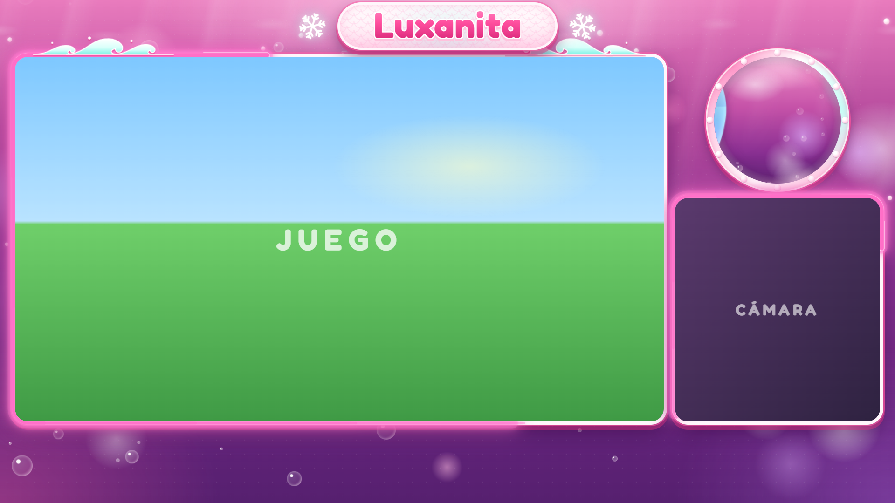
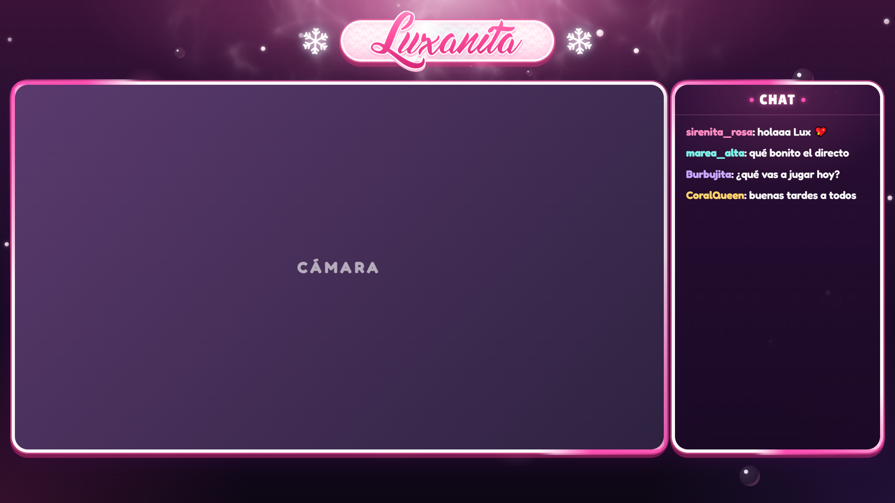
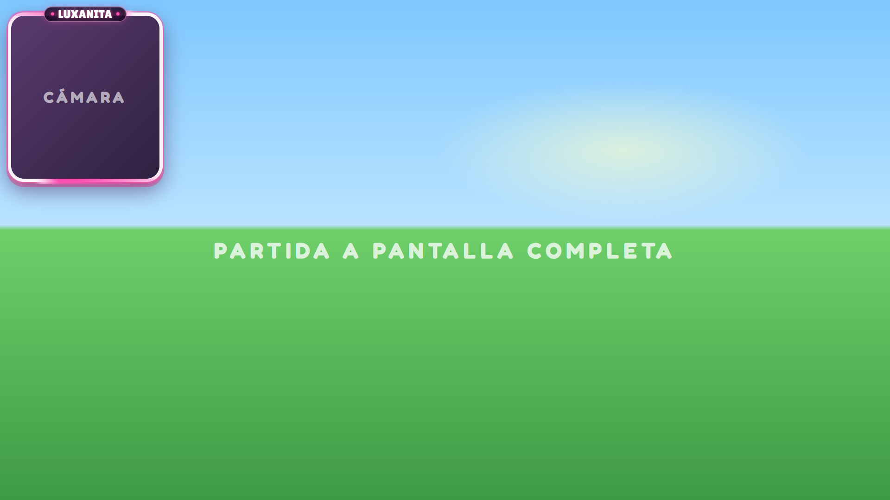
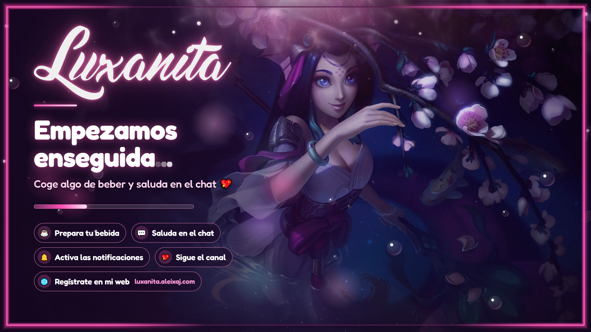
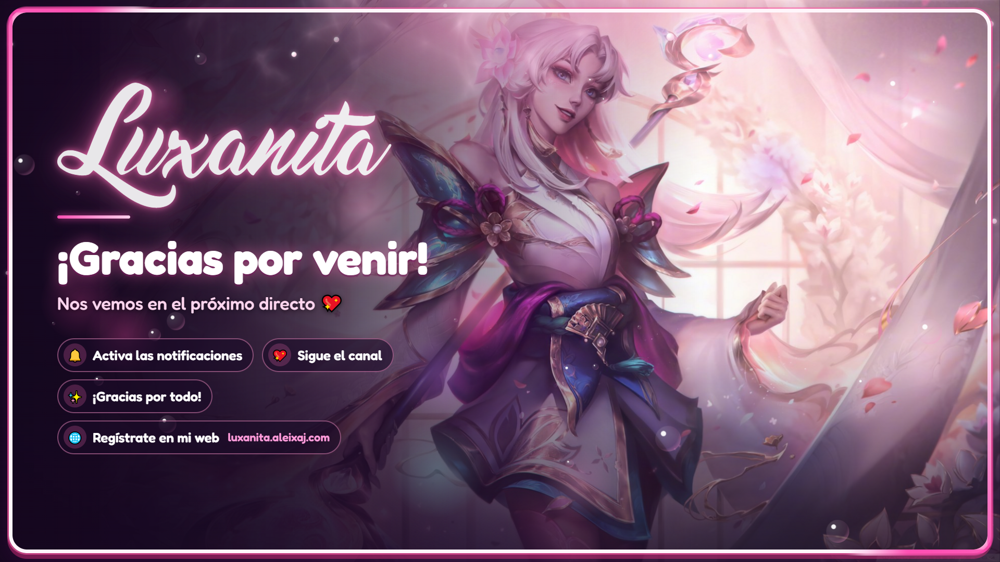

<h1 align="center">Luxanita · Alertas y overlay para Twitch</h1>

<p align="center">
  Alertas para Streamlabs y escenas de overlay para OBS del canal <b>Luxanita</b>.<br>
  Temática submarina y rosa, inspirada en Nami y Lux de League of Legends.
</p>

<h2 align="center">DESCARGA</h2>

<p align="center">
  <a href="https://github.com/AleixAj/alertastwitch/releases/latest/download/Luxanita-overlay-y-alertas.zip">
    
  </a>
</p>

<p align="center">
  <sub>Windows, Mac o Linux · Se descomprime, se abre el <code>INICIO.html</code> y desde ahí se ve todo · Los pasos, en <code>INSTRUCCIONES.txt</code></sub>
</p>

<p align="center">
  
</p>

## Qué incluye

**Alertas** (Streamlabs Alert Box, HTML/CSS/JS propio): follow, sub, subs regaladas y raid.
Cada una lleva su sonido. Hay tres versiones:

| Carpeta | Cómo se ven |
| --- | --- |
| `grandes/` | Grandes, en el centro y con efectos por toda la pantalla |
| `compactas/arriba/` | Pequeñas, arriba en el centro; no tapan el juego |
| `compactas/centro/` | Pequeñas, en el centro |

**Overlay** (`overlay/`, fuentes Navegador de OBS a 1920x1080):

| Archivo | Escena |
| --- | --- |
| `overlay.html` | Jugando: juego grande, cámara y ventana de acuario con animales |
| `partida.html` | Juego a pantalla completa con la cámara pequeña |
| `charla.html` | Cámara grande y panel para el chat |
| `empezando.html` | Antes de empezar, con cuenta atrás opcional (`?minutos=5`) |
| `descanso.html` | Pausa |
| `final.html` | Despedida |
| `camara.html` | Solo el marco de la cámara, para colocarlo donde se quiera |

Todos los marcos llevan una línea de neón rosa con dos tramos que dan la vuelta.
Los huecos del juego y la cámara son transparentes en OBS.

| Charla | Partida |
| --- | --- |
|  |  |
| **Empezando** | **Despedida** |
|  |  |

## Instalación

Todos los pasos, explicados para quien no ha montado nunca un overlay, están en
[INSTRUCCIONES.txt](INSTRUCCIONES.txt).

El zip del botón de arriba se vuelve a crear solo cada vez que cambia algo del
proyecto (lo hace `.github/workflows/paquete.yml`), así que el enlace siempre lleva la
versión de ahora.

Para crearlo en tu ordenador:

```bash
python crear_paquete.py
```

Deja en `dist/Luxanita-overlay-y-alertas.zip` solo lo necesario: alertas, overlay e
instrucciones, sin scripts ni capturas.

## Verlo sin OBS

Abre cualquier escena del overlay en el navegador. Añade `?demo` a la dirección para verla
con un juego y una cámara de ejemplo, por ejemplo `overlay/overlay.html?demo`.
Fuera de OBS, los huecos transparentes salen a cuadritos.

Las alertas se prueban abriendo el `preview.html` de cada carpeta.

## Para quien edita el proyecto

- `overlay/comun.js` y `overlay/comun.css` tienen todo el diseño común. Cada escena es un
  `.html` pequeño que llama a `montarEscena({ ... })`; las opciones están explicadas al
  principio de `comun.js`.
- `crear_compactas.py` crea las alertas compactas a partir de las grandes. No se editan a mano.
- `sync_preview.py` actualiza el `preview.html` de las alertas grandes.
- `sonidos/generar_sonidos.py` genera los sonidos (Python + ffmpeg).
- `overlay/generar_causticas.py` genera los reflejos de luz del fondo.

## Licencias de lo que no es nuestro

- **Animales**: [Fluent Emoji](https://github.com/microsoft/fluentui-emoji) de Microsoft
  (MIT). La orca está basada en [Twemoji](https://github.com/jdecked/twemoji) (CC BY 4.0).
  Ver `overlay/animales/LICENCIA.txt`.
- **Ilustraciones de Lux y Nami**: splash arts de Riot Games, usados según su política
  *Legal Jibber Jabber* para contenido de fans (no se pueden vender). Ver `overlay/escenas/LEEME.txt`.
- **Fuentes**: Fredoka y Lilita One (SIL Open Font License). El logotipo usa la versión demo
  de *Dream American Diner*, que es **solo para uso personal**: para un canal con ingresos
  hay que comprar la licencia comercial. Ver `overlay/fuentes/LEEME.txt`.
